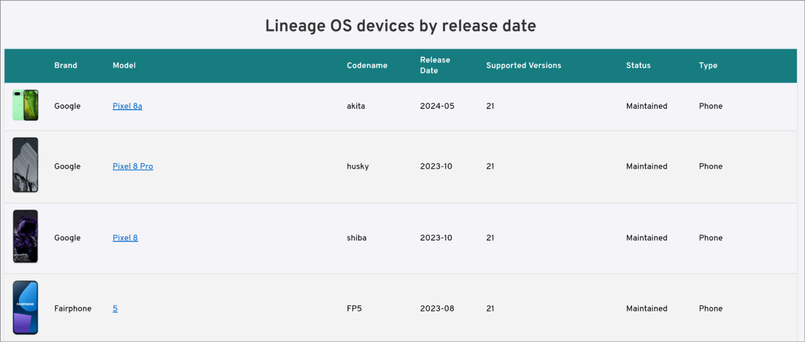

# lineageos-devices-timeline

A simple static website to display the currently supported LineageOS devices by release date. 

## License

[MIT](LICENSE), except for the `lineage_wiki` submodule, which is covered by its own license.
